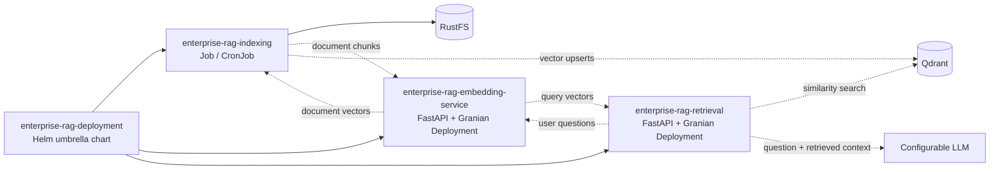
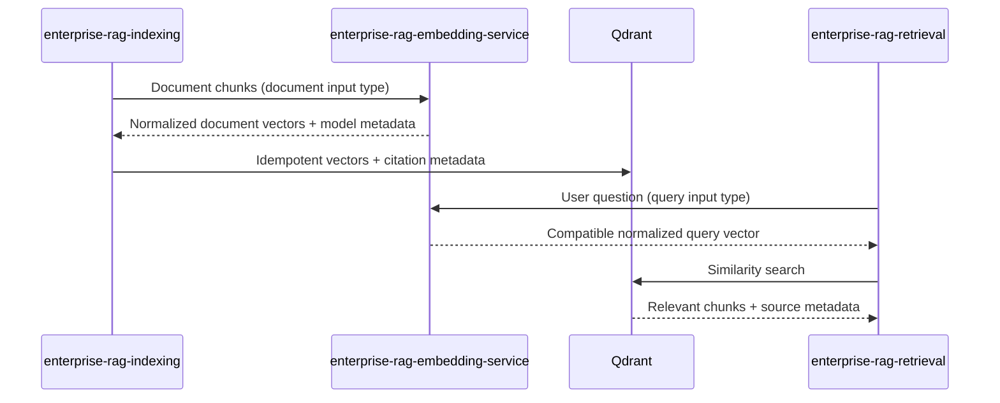

# Enterprise RAG

`enterprise-rag` is the top-level orchestration repository for the Enterprise RAG coding exercise. It brings the asynchronous document indexing pipeline, shared embedding API, RAG query API, RustFS object storage, and Qdrant vector database together with Docker Compose.

The target prototype indexes PDF documents from S3-compatible storage, chunks them, generates embeddings, stores them in Qdrant, and uses retrieved context to answer questions with source references. PDF indexing is the initial scope; additional document formats and advanced retrieval features can be added later. The dedicated embedding service synchronizes and loads the ONNX model from RustFS for local development, and the indexing `v1` pipeline now calls it over pooled HTTPX.

For architecture, coding standards, project boundaries, and implementation guidance, see [`AGENTS.md`](AGENTS.md).

## Repositories

- `enterprise-rag` — orchestrates the complete stack and tracks the component repositories as Git submodules.
- `enterprise-rag-embedding-service` — FastAPI/Granian API that synchronizes and loads the shared embedding model once and vectorizes both document chunks and user questions.
- `enterprise-rag-indexing` — provides a disposable, asynchronous indexing pipeline for documents in RustFS through its S3-compatible API.
- `enterprise-rag-retrieval` — provides the planned FastAPI/Granian RAG query API.
- `enterprise-rag-deployment` — provides the Helm umbrella chart and component subcharts for Kubernetes/OpenShift.

```text
enterprise-rag (Docker Compose)
├── enterprise-rag-embedding-service/ # Git submodule; planned embedding API
├── enterprise-rag-indexing/          # Git submodule; one-shot indexing job
├── enterprise-rag-retrieval/             # Git submodule; planned RAG query API
├── enterprise-rag-deployment/        # Git submodule; Helm umbrella chart
├── RustFS                            # Compose service; S3-compatible objects
└── Qdrant                            # Compose service; vectors + source metadata
```

## High-level architecture

The dashed relationships are planned integration points.





## Git submodules
To add the component repositories to an existing `enterprise-rag` orchestration repository (run in its root directory):
```bash
git submodule add https://github.com/tolga-kabadurmus/enterprise-rag-indexing.git enterprise-rag-indexing
git submodule add https://github.com/tolga-kabadurmus/enterprise-rag-retrieval.git enterprise-rag-retrieval
git submodule add https://github.com/tolga-kabadurmus/enterprise-rag-deployment.git enterprise-rag-deployment
git submodule add https://github.com/tolga-kabadurmus/enterprise-rag-embedding-service.git enterprise-rag-embedding-service
git add .gitmodules enterprise-rag-indexing enterprise-rag-retrieval enterprise-rag-deployment enterprise-rag-embedding-service
git commit -m "Add Enterprise RAG component submodules"
```
### Listing the submodules
```bash
git config --file .gitmodules --name-only --get-regexp path
```
> The GitHub URLs above follow the naming convention of the earlier project. Verify that both repositories have been created under that account before executing these commands. Each repository should have at least one commit.
To clone the orchestration repository with submodules:
```bash
git clone --recurse-submodules https://github.com/tolga-kabadurmus/enterprise-rag.git
cd enterprise-rag
```
If the parent repository was already cloned without submodules:
```bash
git submodule update --init --recursive
```
To pull changes in the parent repository and check out the submodule commits it records:
```bash
git pull --ff-only
git submodule update --init --recursive
```
To intentionally advance a submodule to newer commits, update it inside its directory, then commit the changed submodule pointer from the parent repository. `git submodule update --remote` is another option when a tracking branch is configured; it should not be confused with checking out the parent repository's pinned versions.

## Configuration

Local configuration is owned by the orchestration repository under `dev-envs/`. Docker Compose loads one environment file per service; application settings are validated by the component's Pydantic `BaseSettings` classes. Copy the committed safe template to the corresponding Git-ignored file and replace placeholder credentials. The retrieval template is currently named `enterprise-rag-retrieval.example`; the other templates use the `.env.example` suffix.

| Runtime owner | Local file | Environment variables |
| --- | --- | --- |
| RustFS | `rustfs.env` from `rustfs.env.example` | `RUSTFS_ACCESS_KEY`, `RUSTFS_SECRET_KEY`, `RUSTFS_ADDRESS`, `RUSTFS_CONSOLE_ADDRESS`, `RUSTFS_CONSOLE_ENABLE`, `RUSTFS_OBS_LOGGER_LEVEL` |
| Qdrant | `qdrant.env` from `qdrant.env.example` | `QDRANT__SERVICE__HTTP_PORT`, `QDRANT__SERVICE__GRPC_PORT`, `QDRANT__LOG_LEVEL` |
| Embedding service | `enterprise-rag-embedding-service.env` from `enterprise-rag-embedding-service.env.example` | `EMBEDDING_SERVICE_*` API limits, `S3_*` model-storage access, and `EMBEDDINGS_*` model identity/artifact paths |
| Indexing job | `enterprise-rag-indexing.env` from `enterprise-rag-indexing.env.example` | `S3_*`, `INDEXING_*`, `PDF_CHUNK_*`, `EMBEDDING_SERVICE_*`, `VECTOR_*`, and `QDRANT_*` settings |
| Retrieval API | `enterprise-rag-retrieval.env` from `enterprise-rag-retrieval.example` | `QUERY_API_*`, `EMBEDDING_SERVICE_*`, `QDRANT_*`, `RAG_*`, `RERANKING_*`, and `LLM_*` settings |
| Diagnostic scripts | `diagnostics.env` from `diagnostics.env.example` | Host-facing `S3_ENDPOINT_URL`, `S3_ACCESS_KEY_ID`, `S3_SECRET_ACCESS_KEY`, `S3_REGION`, `QDRANT_URL`, and `QDRANT_API_KEY` |

Container-to-container endpoints use Compose service names such as `http://rustfs:9000`, `http://qdrant:6333`, and `http://enterprise-rag-embedding-service:8081`; host-run diagnostics use published `localhost` ports. The embedding model identity and dimension, Qdrant collection/vector names, and embedding response expectations must agree across embedding, indexing, and retrieval. Never commit the real `.env` files or credentials. See each component README for variable-level defaults and constraints.

## Run the complete project
Prerequisites: Docker Engine with the Compose v2 plugin; Git; Python 3.12.3 and `virtualenv` for host-based Python development. The primary target is Ubuntu 24.04.4 LTS.
Clone with submodules using the command above, or update them if already cloned. Copy each file in `dev-envs/` by removing its `.example` suffix, then set RustFS credentials, S3 endpoints, Qdrant connection details, and embedding/LLM provider settings. Each application has its own root-level environment file, including `dev-envs/enterprise-rag-embedding-service.env`. Only safe `.env.example` templates belong in Git; do not commit real environment files or secrets.
The root S3 and Qdrant diagnostic scripts load validated settings from `dev-envs/diagnostics.env` through Pydantic `BaseSettings`. Create it from `dev-envs/diagnostics.env.example`; the real file is Git-ignored. The embedding service synchronizes `s3://models/embeddings/intfloat/multilingual-e5-small/` into `/models/embedding/intfloat/multilingual-e5-small`; indexing now requests document vectors over HTTP instead of loading that model. `S3_PROCESSING_BUCKET=documents-processing` stores claimed in-progress documents, while `INDEXING_WORK_DIRECTORY=/work/indexing` points at the temporary `indexing-work` volume.
The current root `docker-compose.yaml` implements development services named `rustfs`, `qdrant`, `enterprise-rag-base`, `enterprise-rag-indexing`, and `enterprise-rag-embedding-service`. The query service shown in the diagrams is not a Compose service yet. The indexing and embedding builds consume `enterprise-rag-base` as a service-backed build context, so Compose builds the base image before those images. Their runtime dependencies also start the base service first. The `indexing-work` volume is temporary scratch space; Kubernetes Jobs/CronJobs should use an `emptyDir` at the same mount path. Durable processing objects remain in RustFS.
Build the indexing image and its base dependency:
```bash
docker compose --profile dev build enterprise-rag-indexing
```
Start the persistent development infrastructure:
```bash
docker compose --profile dev up -d rustfs qdrant
```
Inspect the services and their logs:
```bash
docker compose ps
docker compose logs -f rustfs qdrant
```
Execute an on-demand indexing job (use the actual CLI flags implemented by the indexing application):
```bash
docker compose --profile dev run --rm enterprise-rag-indexing \
  python -m app.main \
  --pipeline v1 \
  --source-bucket documents \
  --key-prefix contracts/2026/ \
  --concurrency 4
```
The registered `v1` job discovers source and resumable processing objects, conditionally claims them, verifies movement into `documents-processing`, loads the configured ONNX model, and returns page-bounded PDF text chunks with citation metadata. Embedding inference and Qdrant persistence are not implemented yet, so processing objects remain durable for that later stage. The offline `mock-pdf` pipeline remains available for lifecycle diagnostics. Keep `dumb-init` as the image's PID 1 process.
When the query application provides an HTTP endpoint, use the API and documentation URLs defined by the published ports in `docker-compose.yaml`. No host port or endpoint path is fixed yet.
Stop the running services without deleting persistent data:
```bash
docker compose down
```
To remove the stack's named volumes and stored RustFS/Qdrant data (destructive):
```bash
docker compose down -v
```
## Development profile
RustFS and Qdrant are assigned to the `dev` profile:
```bash
docker compose --profile dev up --build
```
A local source bind mount for the indexing service is required by `AGENTS.md`; production-style builds or a `prod` profile may be added later but are not currently implemented.
## Documentation and scope
`AGENTS.md` defines coding conventions, Clean Architecture layers, factory patterns, asynchronous resource lifecycle, the embedding service contract, and the implementation sequence.
MkDocs is the chosen documentation framework; project-specific READMEs remain useful for local development.
Hybrid search, reranking, response streaming, conversation memory, multi-agent workflows, evaluations, Helm, CI/CD, and dashboards are optional follow-on features, not claims about the initial prototype.
This README documents the intended repository and developer workflow. Keep it synchronized with the actual Docker Compose service names, environment templates, entrypoints, API paths, and host ports as implementation proceeds.

## Current limitations

no authenticationno authorization procesed have been covered at the project
