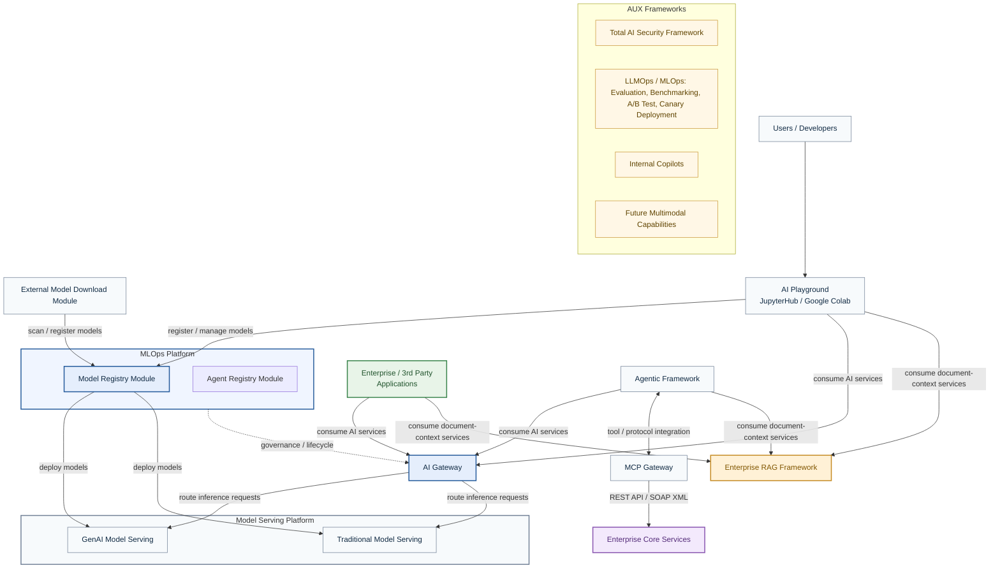
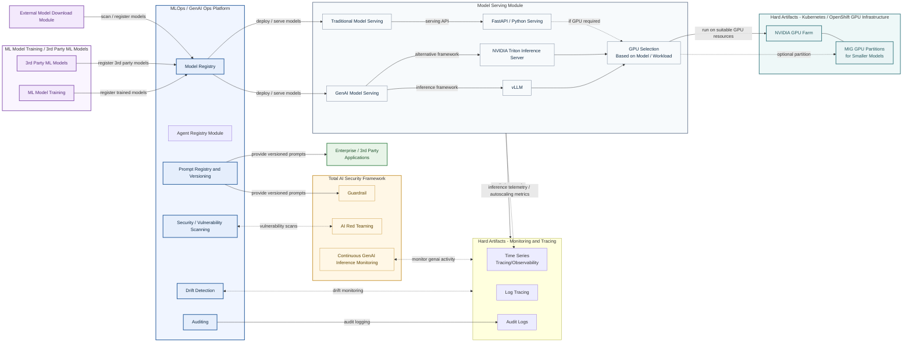
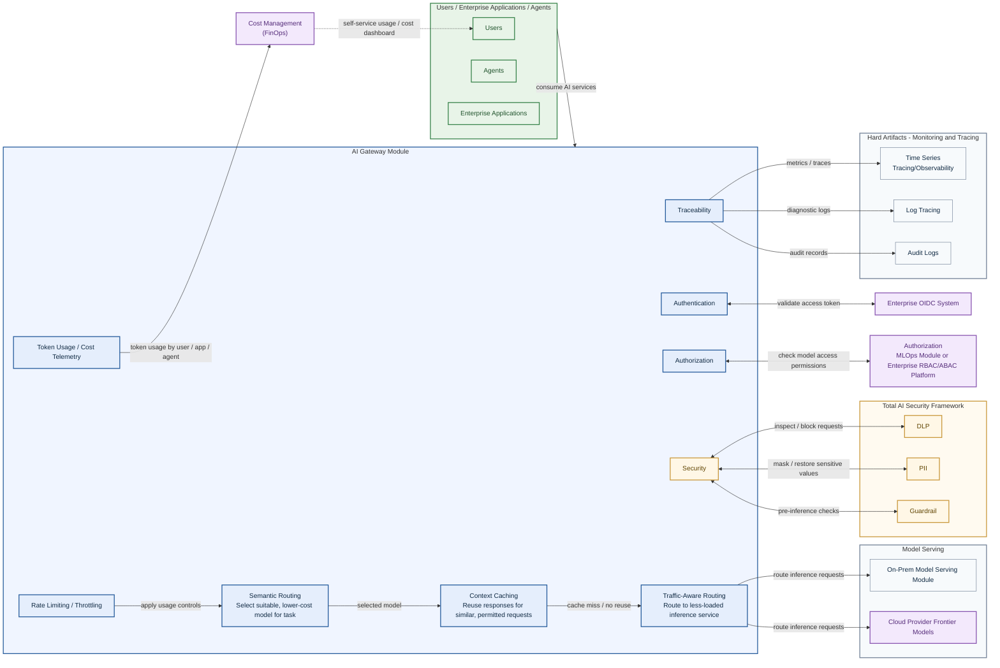
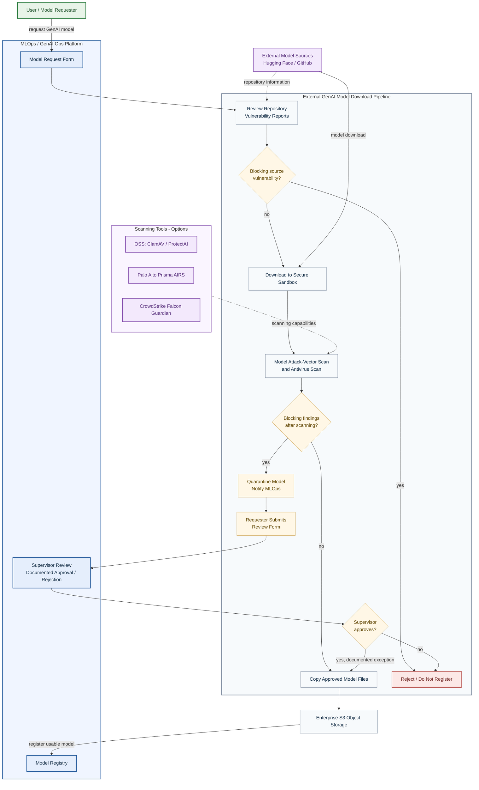
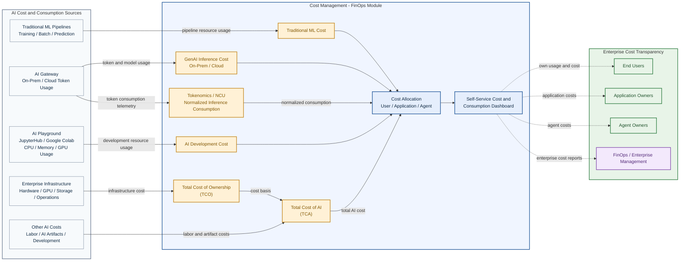
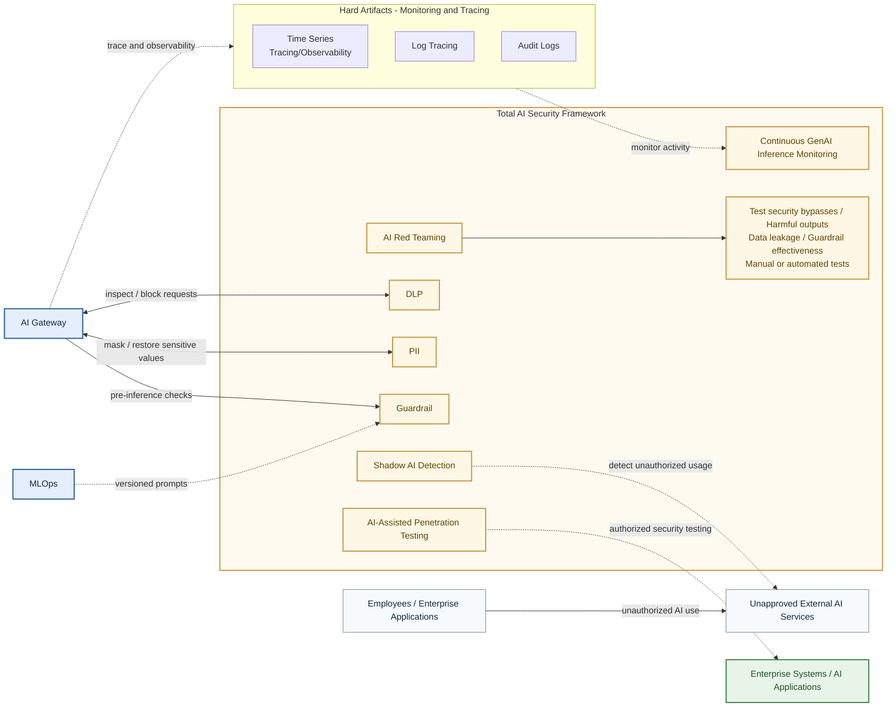
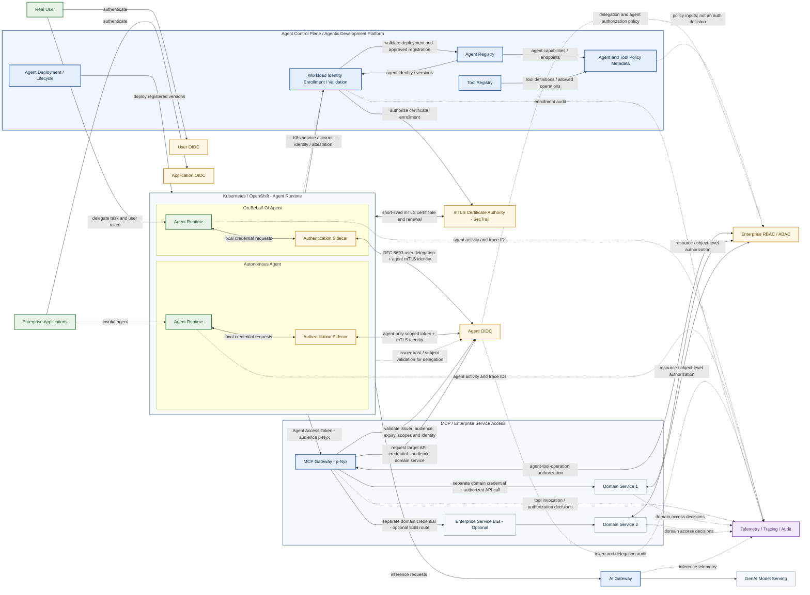
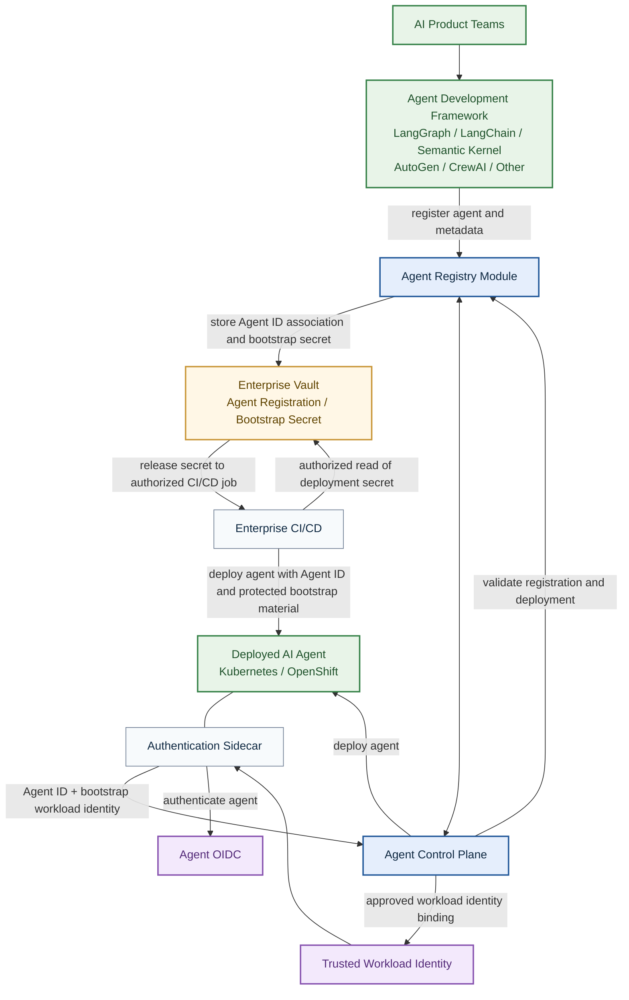

# Building an Enterprise GenAI Platform: Reference Architecture, Security and Governance

# ABOUT
This article aims to give insights on implementing end-to-end GenAI Architecture for an enterprise running completely on-prem, for newcomers.
Also consider it as a proposed reference architecture for the base components of an Enterprise GenAI system. 

# Pre-Requisites
This section gives a quick view of which foundations -as prerequisites- are necessary before implementing a huge GenAI ecosystem.

## Soft Artifacts
Software used to manage, operate, and govern the whole reference architecture. This software must be acquired externally or developed in-house.
  - MLOPS/GenAI Ops Module
  - Model Serving Module: On-prem and cloud frontier models
  - GenAI Gateway
  - RBAC/ABAC System: For authorization
  - OIDC System: For Authentication
  - External GenAI Model Downloading Pipeline
  - Cost Management (FinOps Methodology): for genai and for traditional ai
  - Total AI Security
  - An enterprise level AI Playground
  - MCP Gateway
  - Agentic Framework
  - Data Governance Platform
	- RAG System: For indexing and searching the content
	- Data Lineage: Tracking the data lifecycle
	- Document Search: Secure document search
	
## Hard Artifacts
Namely the foundational components which "the soft artifacts" require before running, such as databases, storage, or hardware artifacts.
Before implementing such a "reference architecture", the hard artifacts below should already be operational and running in a high-availability configuration as a prerequisite!
  - Modern Object storage: Red Hat Ceph S3 Storage or MinIO Enterprise or Object Storage (Huawei)
  - Document Database: MongoDB
  - Big Data or LakeHouse System: 
    - Enterprise grade: Cloudera Big Data Ecosystem (vendor lock-in risk)
	- OSS frameworks: "Apache Hadoop / Spark (Vanilla ecosystem)" or "Enterprise S3 + (Apache Iceberg or Trino)"
  - Vector Database: 
    - Milvus
	  - PROS: GPU support
	  - CONS: enterprise support only on cloud deployment / self on-prem deployment
	- Qdrant (enterprise support) 
	  - PROS: suitable for indexing JSON payloads alongside vectors.
	  - CONS: limited gpu support commonly only cpu
  - Distributed Cache Server: Redis Enterprise
  - Stream/Event Driven Messaging: Cloudera Kafka or Red Hat AMQ Streams. 
  - Timeseries Monitoring and Elastic Search: Grafana and Kibana
  - GenAI Accelerator Hardware Farm: Modern NVIDIA GPU infrastructure
  - Mutual TLS Certification Tools (for auth/authz reasons when ai-agents come into the scene): SecTrail
  - Authentication OIDC Framework: Keycloak or Microsoft ADFS

# RELATIONS OF THE COMPONENTS - High Level Representation
The chart below shows very high-level interactions between the components:
  - MLOps Platform
  - External Model Downloading
  - End users and playground environment
  - AI Agents
  - Applications (enterprise or 3rd party)
  - RAG framework
  - Enterprise Core Services

# EXPLAINING THE SOFT ARTIFACTS STEP BY STEP

## MLOPS/GenAI Ops Module
### Model Registry
The module must cover the AI model types below and be compatible with managing both **inhouse developed** and **3rd party downloaded models**
  - Traditional AI, Model Registry Module
  - GenAI Model, Model Registry Module
### Security/Vulnerability Scanning
  - The capabilities of GenAI models are increasing, and the attack surface is increasing. So the module must scan most types of GenAI and traditional AI models for vulnerabilities.
  - Red teaming capabilities for scanning the system-wide attack surface 
  - Continuous model scanning
  - Shadow AI usage
  - DLP
  - Continuous GenAI activity tracking and assessment
### Drift Detection
System should track and save "online or batch traditional ml predictions" and "feature values at prediction time". 
With a periodic job, all historical predictions and features should be monitored for drift.
### Auditing
  - All activities must be audited and ready to be queried, reported, or used for alerts.
### Prompt Registry and versioning
A "prompt registry and versioning" is an essential tool in cases of:
- Guardrail usage  
- Structuring and deploying the system prompts when using LLM inference time, for the different needs/usecases (sharing the correct prompt templates over the enterprise for the applications/users/agents)
In order to govern prompts "MLflow Prompt Registry" would be a good choice but some enterprises decide to develop in-house. 
In "MLflow Prompt Registry", versioning, aliasing, diffs, and SDK support are available. 

### Model Serving Module
The module should manage one-click REST API serving infrastructure with an easy UI.
  - traditional ML Models: one click python fastapi deployments with an easy to use sdk
  - GenAI Models: one click deployments with an easy to use sdk. The OpenShift AI product claims to do that task, but I have not validated it through hands-on experience. Example inference frameworks:
    - VLLM: Community's widely used framework
	  - PROS: easy to deploy, development community supported by Red Hat
	  - CONS: Optimized to work on just a single model 
	- NVIDIA Triton Inference Server: 
	  - PROS: Multiple models such as LLM/Vision/Embedding can run at the same time 
	  - CONS: Learning curve and expensive effort to implement it as a one-click deployment
  - Cloud frontier models serving: The module needs to interact with external frontier model providers. Assume there is no on-prem deployment for cloud models, since cloud providers have their own deployment user interfaces and strategies.
IMPORTANT #1: Telemetry metrics which is defined in inference framework (for vllm generated tokens per second, page size, vllm queue size/time etc.) should be exported to Prometheus like system to trigger any "Horizontal Pod Autoscaler"
IMPORTANT #2: The module should work with MIG (multi instance gpu) partitions for relatively small genai models such as voice and video models.

### Gathering Those Components Together
Below chart shows "MLOPS/GenAI Ops" module and "Model Serving Module" interactions together;
  - "MLOPS/GenAI Ops"
    - Model Registry
    - Agent Registry
    - Security/Vulnerability Scanning
    - Drift Detection
    - Auditing
    - Prompt Registry and Versioning

  - "Model Serving Module" module interactions;
    - With a GPU infrastructure operated on a Kubernetes/OpenShift environment
    - Selecting inference framework vllm / nvidia triton
    - Selecting suitable gpu instance for genai model and workload

## AI Gateway Module
The module must let enterprise-wide "real users/applications/on behalf of agents/autonomous agents" consume GenAI services securely. 
### Possible consumers
  - Real users/applications
  - On behalf of agents: The agents execute tasks on behalf of the end-user in an assistant role
  - autonomous agents: The agents execute enterprise tasks without needing a human nearby such as coding/reviewing/document discovery/classifying agents
### The gateway responsibilities
  - Authentication: Must be checked with OIDC level access-tokens, any hard code api-keys should not be allowed.
  - Authorization: Must be controlled through the "Enterprise RBAC Platform" or implemented as a separate "MLOps Platform Module" at the client and consumed-model granularity.
  - Traceability: Must trace and store diagnostic/audit/telemetry data
    - Audit logs: GenAI activity -sensitive ones should be carefuly obfuscated- (request/response) should be stored in a cold storage such as S3.
	- Diagnostic logs: To track any unpredicted gw/genai behaviours or end-user complaint all activity logs must be stored. For example last 1 week activity (db) in a hot storage but older than 1 week activity in a cold storage (S3)
	- Telemetry logs: Should be exported to an external monitoring system (Grafana) to track the gw and genai inference latency metrics/token usage metrics and to set the alarms based on it. Frankly every ativity on gateway side or inference side should be exported to telemetry system in order to monitor the system health!
  - Rate Limiting and Throttling: For fair usage of the available resources, rate limiting and throttling are a must.
  - Semantic routing: Selecting cheaper but suitable models for tasks.
  - Context caching: For quick responses and not overwhelming the system resources, based on a "similarity threshold of user prompt/context" and based on "the criticality of the task!" answer from the cache.
  - Traffic-Aware routing: A good gateway also knows the load on upstream GenAI inference services and should route requests to a less-loaded upstream service.
  - Cost management (finops) telemetry outputs of token usage
### Suggestions: 
- LiteLLM: With on-prem deployment and enterprise support highly coverage for above requirements. A bit like an industry standart tool
- True Foundry: With on-prem deployment and enterprise support highly coverage for above requirements also including mcp gateway

### Gathering Those Components Together
Below chart shows how an AI Gateway works with the below functionalities;
  - Authentication
  - Authorization
  - Traceability/Observability
  - Rate Limiting and Throttling
  - Semantic routing
  - Context caching
  - Traffic-Aware routing
  - Cost management (finops) telemetry outputs of token usage

## OIDC System
The system must authenticate the "real users" / "on behalf of agent" / "autonomous agent" but each of authentication must be managed with a different path
### Authentication Paths Of OIDC System
#### Real users
  - With a frontchannel or backchannel, an "access token"/"refresh token" pair should be created
  - AI gateway and RAG framework should authenticate "user access token". If the token is authenticated, the next stage will be authorization.
#### On Behalf of Agents
  - Every agent has its own mutual TLS certificate
  - An "on behalf of agent" must introduce itself to OIDC with the certificate, agent id (or Active Directory credentials) and "real user's access token" and finally must acquire a very short-lived "on behalf of token"
  - AI gateway and RAG framework should authenticate "on behalf of token". If the token is authenticated, the next stage will be authorization.
#### Autonomous Agents
  - Every agent has its own mutual TLS certificate
  - An "autonomous agent" must introduce itself to OIDC with the certificate, agent id (or Active Directory credentials) and finally must acquire a very short-lived "agent access token"
  - AI gateway and RAG framework should authenticate "agent access token". If the token is authenticated, the next stage will be authorization.
### Kill Switch
In case of any uncontrolled agent activity (or less probable but real user activity) the OIDC system must set a kill switch in order to reject the authentication activity!

## RBAC/Object-Based Authorization or ABAC (attribute-based access control) System
Responsibilities of the system
- The system should answer below questions and must work with OIDC:
  - Is the end-user allowed to request on that GenAI inference or to get that vectorized document/document chunk
  - Is the "on behalf of agent" allowed to request on that GenAI inference or to get that vectorized document/document chunk
  - Is the "autonomous agent" allowed to request on that GenAI inference or to get that vectorized document/document chunk
- Fine grained permissions (ABAC): system should cover the fine grained permission requests such as "Is the end-user allowed to execute on X resource within Y,Z values ..."

## External GenAI Model Downloading Pipeline
The system can download GenAI models from external sources such as HuggingFace or Github through a secure process, with no known blocking vulnerabilities after scanning.
The execution path should be;
  - end user requires a genai model (fill a form on MLOPS Module)
  - reading the source genai model repositories vulnerability reports. If any blocking vulnerability is reported in the source repository, reject the model.
  - downloading the model in a secure sandbox location
  - executing genai attack vector and anti virus scans. If any blocking vulnerability is found, quarantine the model and notify the MLOps system. 
  - If the model is in quarantine, expect a form from the requesting user and then a documented supervisor review
  - If no blocking vulnerabilities are found, initiate a copy job for the model files from sandbox to enterprise S3 environment
  - Register it on the MLOPS platform as a usable genai model

The critical part here is scanning the genai model and the available tools are;
  - OSS tools: ClamAV antivirus and ProtectAI
    - PROS: Open source and free to use
	- CONS: Does not cover all GenAI models, and the database is out of date
  - Palo Alto Prisma AIRS Platform:
    - PROS: Palo Alto has claimed ProtectAI and has started to support it in enterprise way.
  - CrowdStrike Falcon Guardian: Not just for genai model security/vulnerability scan tool. A total AI security framework.

### Gathering Those Components Together
Below chart shows how an external model pipeline should work;

## Cost Management (FinOps Methodology)
Since GenAI infrastructure is expensive to operate, monitoring consumption is important.
But the Cost Management system should not stick to just GenAI cost. It should cover the items below and connect them together:
  - Cover traditional ML pipeline cost
  - Cover GenAI inference cost for both on-prem and on-cloud usage
  - Cover ML development cost on Jupyter Hub or Google Colab with regarding traditional resources such as cpu, memory
  - Total Cost Of Ownership for the hardware infrastructure
  - Total Cost of AI for the labor prices, each ai artifact's cost etc.
  - Business value calculation and whether testing that value justifies the total investment on ai assets totally
  - Should stay on Tokenomics rules described in [Tokenomics for Enterprises](https://medium.com/@ktolga_37135/ai-tokenomics-for-enterprises-from-on-prem-gpu-cost-to-total-cost-of-ai-and-business-value-80a74e61ccee?source=friends_link&sk=c2d2eb43cb1b21df6c6c47c601a27422)
IMPORTANT #1: Cost tracking must be granular and accountable on "end user" / "application" / "agent" level.

### Gathering Those Components Together

## Total AI Security
Total AI security must consist of the subjects below:

### Shadow AI: 
Any unauthorized ai usage should be detected.

### DLP (Data Leakage Prevention): 
For a highly regulated industry such as financing it is very important to reject any request in case including customer value. And some other companies be careful about their intellectual property in case of any leak to cloud ai systems.

### PII (Personally Identifiable Information): 
Any PII data should be masked before sending to cloud ai providers. and if exists in the genai response must be re-fill in the correct sequence.

### Guardrail: 
It's the first place protection layer before genai inference gets started. 
Guardrails check AI requests and responses against defined security and usage rules. They may use prompt-based checks or other detection methods.

Some of the base attacks that can be captured with a proper Guardrail
  - Prompt injection mitigation: Prompt injection occurs when an attacker manipulates the prompt to cheat the LLM for ignoring its original instructions
  - System Prompt Stealing Prevention: System prompt stealing occurs when an attacker try to force the LLM to acquire the underneath instructions or logic.
  - Jailbreak: An attacker tries to bypass safety alignments to generate harmful content.
  - Toxicity and Sentiment Filtering: Scans both input and output for hate speech, racism, profanity, harassment etc.

### AI Red Teaming
AI red teaming is important when decide to;
  - Test bypassing safety controls
  - Trigger harmful outputs
  - Discover data Leakage
  - Test guardrails
Red teaming can be done by "manual (with highly educated human)" or "automated (with some commercial tools, such as CrowdString Falcon or Palo Alto Prisma AIRS)" 
A recommended tool is "CrowdStrike Safemind"

### Continuous GenAI Inference Monitoring
Tracking request and responses of genai inference is very important (no matter batch or real time tracking).
Because with the power of ai the attack surface is always getting increasing easily but most of the assets which we have is static such as guardrails.
Though enterprises find a way to Continuously monitor the genai activity for vulnerabilities.
Also when agents come into play "Continuous GenAI Inference Monitoring" staff would transform into "Agent Activity Real Time Monitoring". For that topic, review [Google Article - Inside Agent Compute Engine](https://cloud.google.com/blog/topics/ai-infrastructure/agent-compute-engine-deep-dive)

### Pentest With AI Support
AI pentest, automates and scales complex cyberattacks, forcing security teams to use AI just to keep up with hackers.
There is some commercial tools to execute that kind of test but a highly trained person can achieve same goal with open-weight exploit models.
A recommended tool is "CrowdStrike Safemind"

### Gathering Those Components Together
Below chart shows a quick reference for how an enterprise should face with "Total AI Security" with below subjects.
  - Shadow AI
  - DLP
  - PII
  - Guardrail
  - Continuous GenAI Inference Monitoring
  - AI Red Teaming
  - Pentest With AI Support

## An Enterprise Level AI Playground
An AI playground is an environment where, the environment -but before production, just a playground- where the users can write python code in order to develop or test ai models, implement some quick mvp genai solutions on their own.
The playground should centralize data access, enforce strict enterprise security, optimize costly GPU resource allocation, and ensure seamless team collaboration for rapid machine learning development.
For that functionality, the tools below are useful
  - JupyterHub: oss, on-prem, runs on container based kubernetes environment
  - Google Colab: Just on cloud no on-prem

## Enterprise RAG / Secure Document Search
The Enterprise RAG platform should discover, register, index, and search unstructured documents from enterprise data sources. The first focus is secure document search, keeping document metadata and permissions linked to the original source.

### Document Discovery and Registry
- A scheduled discovery workflow finds documents from existing enterprise sources.
- The source integration runs through MCP (p-Nyx in the draft), covering SharePoint, Enterprise Content Management, relational/document databases, and S3 object storage.
- The discovery process should consider source RBAC permissions.
- MongoDB serves as the Document Registry and holds information needed to track documents, versions, source locations, and permissions.
- A Document Registry UI allows new sources to be registered and monitored.
- Real users or enterprise applications may submit new or updated documents through the Document Load process.
- Document Load publishes new or modified document events through the Event-Driven Architecture to trigger the discovery workflow.
- Source permission changes should also publish events to trigger Document Permission Synchronization.
- Document Permission Synchronization retrieves the latest permissions from the original source and updates the Document Registry and Vector Database permission metadata.

### Document Indexing
- Compare discovered documents with their registered versions.
- Start an indexing workflow for new or changed documents. Skip unchanged documents.
- Parse the document and store its content and metadata in enterprise object storage.
- Chunk the parsed content, generate embeddings, and upsert the results into the Vector Database.

**Embedding Generation**
- An embedding model converts document chunks into numerical vectors representing their semantic meaning.
- The embedding model must support Turkish and multilingual document retrieval.
- **Qwen3-Embedding-0.6B** is the primary candidate for evaluation. It is an open-weight multilingual embedding model with Turkish language support, suitable for on-prem deployment.
- **BAAI/bge-m3** is an alternative candidate. It supports multilingual embeddings and both dense and sparse retrieval, making it suitable for Hybrid Search.
- The final embedding model should be selected after evaluating retrieval accuracy and inference performance on Turkish enterprise documents.
- The selected embedding model should be managed and versioned so that document indexing and search use compatible embeddings.

**Vector Indexing**
- Store embeddings and their associated metadata in the Vector Database.
- Each indexed chunk should keep references to its original document, version, source location, and permission attributes.
- The Vector Database should support vector similarity search, keyword search, and metadata filtering for Hybrid Search.

### Enterprise RAG / Secure Document Search
- Real users and enterprise applications access Enterprise RAG through a REST API.
- Authenticate requests using Enterprise OIDC.
- Authorize requests using enterprise RBAC/ABAC.
- Document and chunk access must follow the original source permissions.
- Permission changes should be synchronized through the Event-Driven Architecture and reflected in the Document Registry and Vector Database.

**Chunking Strategy**
- Static chunking: Split documents into fixed-size chunks with some overlap between them. It is simple to implement and fast, but sometimes breaks a sentence or related content.
- Semantic chunking: Split documents based on meaning and topic changes instead of fixed sizes. It may keep related information together, but requires more processing and evaluation.

**Retrieval Strategy**
- Use Hybrid Search by combining vector similarity search and keyword search.
- Convert the user's search query into an embedding using a compatible embedding model.
- Retrieve relevant chunks using semantic similarity and keyword matching.
- Apply document-level permission filters so that users only retrieve documents and chunks they are authorized to access.
- Use Document Registry metadata to identify the original documents and their versions.
- Reranking will not be implemented in the initial version.

**Prompt Construction**
- For RAG answer generation, construct the LLM prompt using the user's question and authorized retrieved document chunks.
- Include instructions that the LLM should answer based on the provided document context.
- Send the prompt to the selected LLM through the existing AI Gateway.

**Citation Strategy**
- Generated answers should include references to the original documents used as context.
- Citation metadata should be stored alongside each document chunk in the Qdrant Vector Database using its JSON payload capability.
- Each Qdrant payload should contain the document ID, chunk ID, document version, document title, source location, and page or section information when available.
- The Enterprise RAG API should retrieve citation metadata directly from the authorized Qdrant search results, without requiring additional MongoDB queries for each citation.
- MongoDB Document Registry remains the authoritative source for document metadata, versions, and lineage. Citation metadata stored in Qdrant must stay synchronized with the Document Registry.
- Generated citations should be based on the actual retrieved document chunks, not on document references generated independently by the LLM.
- The Enterprise RAG API should return the generated answer together with its source citations so users can verify the information.

**Hallucination Prevention**
- The LLM should be instructed to generate answers based on the retrieved document context.
- If the retrieved documents do not contain sufficient information, the system should indicate that there is not enough evidence to answer. As a system-prompt-level guardrail, a fallback instruction should be defined, such as: "If the retrieved context does not provide sufficient evidence to answer the user's question, do not generate an answer based on assumptions or the model's own knowledge. Instead, return a predefined fallback message indicating that insufficient evidence was found."
- Generated answers should include source citations so users can verify the information.
- These controls reduce hallucination risk but do not guarantee that every generated answer is correct.

### Gaps - Not Covered Subjects
- Semantic Chunking (a better approach instead of static chunking)
- Multimodal RAG
- Ontology
- Graph RAG
- Semantic Layer
- Natural Language Queries

### Gathering Those Components Together
The chart below shows a sample of how an enterprise RAG, Vector Search, and Document Discovery tasks might work;

```mermaid

flowchart LR
    subgraph CLIENT_CONTAINER[Enterprise Document Sources]
        USER[Real Users]
        APP[Enterprise / External Applications]
    end

    UI[Document Registry UI]
    LOAD[Document Load]
    EVENT[Event Driven Architecture]
    MCP[MCP - Source Access]

    subgraph SOURCE[Enterprise Document Sources]
        SP[SharePoint]
        ECM[Enterprise Content Management]
        DB@{ shape: cyl, label: "Relational / Document Databases" }
        S3SRC@{ shape: cyl, label: "S3 Object Storage" }
    end

    subgraph GOVERNANCE[Unstructured Data Governance - Discovery and Indexing]
        WORKFLOW[Trigger Document Discovery Workflow]
        DISC[Scheduled Document Discovery]
        DOCREG[MongoDB - Document Registry]
        COMPARE{Version Compare}
        INDEX[Index Workflow]
        PARSE[Document Parsing]
        CHUNK[Chunking and Embedding]
        OBJECT[Enterprise Object Storage]
        VECTOR[Vector Database - Upsert / Hybrid Search]
        PERMSYNC[Document Permission Synchronization]
    end

    subgraph RAG[Enterprise RAG / Secure Document Search]
        API[Enterprise RAG REST API]
        RETRIEVE[Hybrid Retrieval - Vector + Keyword]
        ANSWER[Prompt Construction / Citations / Answer]
    end

    OIDC[Enterprise OIDC]
    AUTHZ[Enterprise RBAC / ABAC]
    GW[AI Gateway / Model Serving]

    LOAD -.->|upload/modify document content| SOURCE
    LOAD -->|publish new/modify document event| EVENT
    CLIENT_CONTAINER -.->|upload/modify document| LOAD
    DISC -->|trigger workflow| WORKFLOW
    EVENT -->|trigger workflow| WORKFLOW
    WORKFLOW <-->|discover periodically| MCP
    WORKFLOW --> DOCREG
    COMPARE -.->|temp download source document| MCP
    MCP -->|discover documents| SOURCE
    DOCREG --> COMPARE
    COMPARE -->|new or changed| INDEX
    COMPARE -->|unchanged| DOCREG
    INDEX --> PARSE
    PARSE -->|store content / metadata| OBJECT
    PARSE --> CHUNK
    CHUNK --> VECTOR
    DOCREG <-.->|serves the configuration<br/>shows lineage| UI
    UI -->|login| OIDC

    CLIENT_CONTAINER -->|document search| API
    API -->|authenticate| OIDC
    API -->|authorize/permissions| AUTHZ
    MCP -.->|authorize/permissions| AUTHZ
    UI -.->|authorize/permissions| AUTHZ
    AUTHZ -.->|get permissions from source| SOURCE

    SOURCE -.->|publish permission change event| EVENT
    EVENT -->|trigger permission sync| PERMSYNC
    PERMSYNC <-->|read current source permissions| MCP
    PERMSYNC -->|update document access metadata| DOCREG
    PERMSYNC -->|update permission filters / revoke indexed access| VECTOR

    API -->|search indexed chunks| RETRIEVE
    RETRIEVE -->|hybrid search with permission filters| VECTOR
    RETRIEVE -->|resolve document metadata / citations| DOCREG
    RETRIEVE -->|check requester access| AUTHZ
    RETRIEVE -->|authorized context| ANSWER
    ANSWER -->|inference via gateway| GW
    ANSWER -->|answer with citations| API

    classDef governance fill:#e5eefc,stroke:#245a9b,stroke-width:2px,color:#102a43
    classDef sources fill:#f7fafc,stroke:#718096,color:#102a43
    classDef rag fill:#fff1d6,stroke:#c58a22,stroke-width:2px,color:#805600
    classDef auth fill:#f3e9fc,stroke:#8854b0,stroke-width:2px,color:#542b79
    class DISC,WORKFLOW,LOAD,MCP,DOCREG,COMPARE,INDEX,PARSE,CHUNK,OBJECT,VECTOR,UI,PERMSYNC governance
    class SP,ECM,DB,S3SRC,USER,APP sources
    class API,RETRIEVE,ANSWER rag
    class OIDC,AUTHZ,GW auth
    style GOVERNANCE fill:#f0f5ff,stroke:#245a9b,stroke-width:2px
    style SOURCE fill:#f7fafc,stroke:#718096,stroke-width:2px
    style RAG fill:#fffaf0,stroke:#c58a22,stroke-width:2px

```

## Agentic AI Applications and MCP
The Agentic AI platform should support **On-Behalf-Of Agents** and **Autonomous Agents**. Agents run on Kubernetes/OpenShift, use an authentication sidecar, consume GenAI models through the existing AI Gateway, and access enterprise services through the MCP Gateway (p-Nyx). User OIDC, Application OIDC, and Agent OIDC are **separate identity-provider artifacts**, not just different flows within one identity provider.

### Agent Control Plane and Agent Registry
- The **Agent Control Plane / Agentic Development Platform** manages agent registration, tool registration, deployment, lifecycle, and identity enrollment.
- The **Agent Registry** keeps each approved agent's identity, owner, version, endpoint, deployment status, and capabilities.
- The **Tool Registry** keeps tool definitions, owners, target services, operations, and related access-policy metadata.
- **Agent Deployment** deploys approved agent versions to Kubernetes/OpenShift and tracks changes and retirement.
- At startup, the **authentication sidecar** contacts the Agent Control Plane to obtain its registered, trusted agent identity.
- **Bootstrap trust is required:** before issuing that identity or a certificate, the Control Plane validates the sidecar's Kubernetes/OpenShift workload identity (for example a bound service-account token), deployment identity, and approved Agent Registry record. A claimed `agent_id` alone is not proof of identity.
- Once validated, the sidecar requests a short-lived mTLS certificate from **SecTrail**. Certificate renewal and revocation should follow the agent lifecycle.
- The registry and tool metadata can provide policy inputs to Enterprise RBAC/ABAC. **The Registry is not the authorization engine**: RBAC/ABAC makes the access decision at invocation time.

### Agent Authentication
- **User OIDC** authenticates real users; **Application OIDC** authenticates enterprise applications; **Agent OIDC** issues agent-facing tokens and validates delegated-agent identity.
- Do not send reusable Active Directory usernames or passwords from agents. Use the validated workload identity and short-lived mTLS certificates to authenticate agent workloads.
- For an **On-Behalf-Of Agent**, the real user first obtains a user access token from User OIDC. The agent sidecar then requests a short-lived delegated token from Agent OIDC using **OAuth 2.0 Token Exchange (RFC 8693)**. Agent OIDC verifies the user token, the authenticated agent identity, and delegation permissions, then issues a token identifying the agent and delegated user with a limited audience and scopes.
- For an **Autonomous Agent**, the sidecar requests a short-lived, agent-only access token using its authenticated workload identity. No user identity is implied.
- Each receiving service validates the token issuer, audience, expiration, signature or introspection result, and required scopes. The specific trust relationship between independent OIDC providers must be configured explicitly.

### MCP and Domain-Service Authorization
- The **MCP Gateway (p-Nyx)** is the common entry point for agents invoking registered enterprise tools. An optional Enterprise Service Bus remains available for domain-service integration.
- MCP validates the agent's incoming token and checks Enterprise RBAC/ABAC for the agent, requested tool, operation, and delegation context.
- The **downstream domain service** independently checks whether the authenticated identity can perform the requested operation on the requested business resource. Permission to call a tool does not automatically grant permission to access all business records.
- **Agent Access Token (for MCP):** Agent OIDC issues a short-lived access token to the agent or its sidecar. When this token has `aud = p-Nyx MCP Gateway`, its purpose is to authorize the **Agent → MCP Gateway** call. This is a standard OAuth access token, not a separate MCP-specific token type. The token may identify an autonomous agent or an agent acting on behalf of a user.
- **Do not forward the Agent Access Token unchanged to a downstream Domain API.** For example, an agent invokes the `getStatement` MCP tool with its Agent Access Token. MCP validates that token and checks whether the agent can invoke `getStatement`. But the banking statement API is a **different protected service**: a token issued for the MCP Gateway is not automatically valid for the banking API. Forwarding it unchanged would let a token intended for one service be reused at another and would bypass the intended service-specific security boundary.
- **Downstream Domain API credential:** After the MCP tool call is authorized, the MCP Gateway obtains or uses a **separate credential accepted by the target Domain API** (for example, an OAuth access token with `aud = core-banking-api`, obtained through an approved token exchange where supported). The Domain API validates that credential and independently checks authorization for the **requested business operation and resource**, such as whether the user may read a particular customer's statement. For an On-Behalf-Of Agent, preserve the authorized user and agent delegation context as supported by the downstream service; for an Autonomous Agent, enforce its own service permissions. Do not assume the MCP authorization decision grants access to all domain data.
- **Two distinct permission checks:** (1) MCP Gateway checks *can this agent call this tool?*; (2) the downstream Domain API checks *can this identity perform this operation on this business resource?* Both decisions should be auditable.
- Tool and domain-service authorization decisions should be traceable in the audit records.

### Observability and Auditing
- Collect authentication and certificate events, identity enrollment, token exchange, tool invocations, RBAC/ABAC decisions, domain-service access decisions, and AI Gateway inference activity.
- Correlate records with `trace_id`, `agent_id`, delegated `user_id` where applicable, `tool_id`, `target_service`, requested operation, decision, and timestamp.
- Sensitive tokens, credentials, and confidential request data should not appear in ordinary telemetry logs.

### Commercial Platform Example
- **Microsoft Foundry Agent Service + Foundry Control Plane / Microsoft Agent 365** is a commercial reference worth evaluating for agent deployment, registry, governance, agent identity, tracing, and agent governance capabilities. It is **not a claim of drop-in compatibility** with the proposed SecTrail / separate OIDC / p-Nyx / on-prem OpenShift architecture; integration and hosting constraints require validation.
- **Amazon Bedrock AgentCore** is another candidate for runtime, identity, gateway and observability capabilities, with its own cloud integration model.

### Agent Development Framework
The enterprise Agentic AI platform should be **SDK-agnostic**. AI Product Teams can develop agents using their preferred framework without being forced to use a specific development SDK.

Some of the available agent development frameworks are:

- **LangGraph:** Suitable for developing complex, stateful agent workflows with human-in-the-loop and durable execution capabilities.
- **LangChain:** Suitable for developing agents with LLM integrations, tool calling, and simpler agent workflows.
- **Microsoft Semantic Kernel:** Suitable for AI applications developed within the Microsoft ecosystem, especially .NET applications.
- **Microsoft AutoGen:** Suitable for multi-agent applications, agent collaboration, and event-driven agent orchestration.
- **CrewAI:** Suitable for developing multiple agents working together on tasks using role-based Crews and structured Flows.

Microsoft Agent Framework is also an alternative to consider for new Microsoft-based agent development, as it succeeds Semantic Kernel and AutoGen.

The enterprise should not enforce a specific development framework. However, all developed agents must follow the same enterprise registration, deployment, authentication, authorization, and monitoring requirements.

**Agent Registration and Deployment**
- Developers can develop agents using any preferred SDK or framework.
- Once development is completed, the agent must be registered in the **Agent Registry Module**, including its metadata, owner, development framework, version, and required capabilities.
- The Agent Registry assigns a unique enterprise **Agent ID** to the registered agent.
- The agent can be deployed using the **Agent Control Plane** or a separate enterprise CI/CD pipeline.
- After deployment, the agent's Authentication Sidecar interacts with the Agent Control Plane to validate the deployed workload against its registered Agent ID and obtain a trusted workload identity.
- The Authentication Sidecar then follows the enterprise certificate and Agent OIDC authentication process.
- Agent access to LLM inference and enterprise tools must follow the existing AI Gateway, MCP Gateway (p-Nyx), and RBAC/ABAC mechanisms.
- Agent execution and tool activities must be monitored and audited through the enterprise observability infrastructure.

The Agent Registry and Agent Control Plane should manage agents independently of the SDK used to develop them. An agent developed using LangGraph, LangChain, Semantic Kernel, AutoGen, CrewAI, or another framework should follow the same enterprise lifecycle and security requirements.

### Only REST/SOAP Communication From MCP to Domain Services
- AI Agents must not directly access enterprise databases, file systems, S3 object storage, or other domain-level resources.
- All access to enterprise domain resources must go through the **MCP Gateway**, using validated **REST APIs or SOAP services**.
- Domain services must be developed and maintained by their responsible **domain-specific software development teams**.
- These teams have the required business and technical knowledge of their domains and are responsible for implementing business rules, input validation, authorization, and data access controls.
- The MCP Gateway should expose approved domain operations as tools, rather than allowing agents to execute arbitrary database queries or directly manipulate underlying resources.
- This approach prevents uncontrolled agent actions from bypassing domain business rules and causing unintended changes or damage to enterprise data.

**The main principle:** AI Agents can request business operations, but only domain services are allowed to execute those operations against underlying enterprise resources.

### A2A Communication
Not covered

### Gathering Those Components Together
Below chart shows a sample frame for agent readiness;

**Reference Framework**

**Agent Deployment**

## Evaluation, Benchmarking, A/B Test, Canary Deployment
The module should help the enterprise evaluate AI models and applications before production and continuously monitor their quality after deployment.

### Evaluation
Evaluate GenAI models and AI applications based on their accuracy, relevance, safety, hallucination risks, and business use-case requirements.

**Evaluation Strategies**

- **Golden Datasets:** Prepare a set of test inputs with expected outputs, approved by domain experts. Run the same tests against different models or model versions and compare the results.
- **LLM-as-a-Judge:** Use another LLM to evaluate model outputs against predefined criteria, such as accuracy, relevance, completeness, and safety. Judge results should be periodically checked against human evaluations.
- **Human Evaluation:** Domain experts manually review model outputs, especially for sensitive business use cases or when automated evaluation is not reliable.
- **Groundedness / Faithfulness Evaluation:** Check whether the generated answer is supported by the provided documents, images, audio, or video content. This is important for hallucination detection.
- **Task-Specific Evaluation:** Use evaluation metrics designed for the model's actual task, such as text generation, image understanding, speech recognition, or video understanding.

**Evaluation by Model Type**

- **Text LLMs:** Use question-answer golden datasets, LLM-as-a-Judge, and human evaluation. Measure factual correctness, instruction following, relevance, hallucinations, and safety. For RAG applications, also evaluate document retrieval quality, groundedness, and citation correctness.
- **Vision-Language Models (VLMs):** Use images with expected answers or annotations. Evaluate image understanding, visual question answering, OCR accuracy, object recognition, and whether the model invents objects or information not present in the image.
- **Speech Models:** For Speech-to-Text (STT), compare transcriptions against reference transcripts using Word Error Rate (WER) or Character Error Rate (CER). For Text-to-Speech (TTS), evaluate speech naturalness, intelligibility, pronunciation, and voice quality using human ratings such as Mean Opinion Score (MOS).
- **Video Models:** For video understanding, use video clips with expected descriptions, events, or answers. Evaluate event recognition, temporal understanding, timestamps, factual accuracy, and hallucinations. For video generation, evaluate visual quality, prompt adherence, temporal consistency, and human preference.

**General Requirements**
- Evaluation datasets and results should be versioned and managed through the MLOps/GenAI Ops platform.
- Evaluation criteria and acceptance thresholds should be defined according to the business use case.
- The Evaluation Team should review results before a model or application is approved for production.

### Benchmarking
- Compare models using quality, latency, throughput, token consumption, and inference cost.
- Benchmark both on-prem and cloud models under comparable conditions.
- **Useful strategies:** Standardized benchmark datasets, load/stress testing, TTFT/TPOT latency measurements, and quality-versus-cost comparisons.

### A/B Testing
- Compare two model or application versions using real production traffic.
- Measure response quality, latency, cost, and user feedback to decide which version performs better.
- **Useful strategies:** Controlled traffic splitting, sticky user assignment, predefined success metrics, and statistical significance testing.

### Canary Deployment
- Route a small percentage of production traffic to a new model or application version.
- Monitor errors, latency, quality, and security before increasing traffic or rolling back.
- **Useful strategies:** Progressive traffic rollout (5% → 25% → 50% → 100%), automated health checks, predefined rollback thresholds, and automatic rollback.

### Integration With Enterprise AI Platform
- Use the existing **MLOps/GenAI Ops**, **Model Serving**, and **AI Gateway** modules for model versions, traffic routing, and telemetry.
- Store evaluation results and make them available to the **Evaluation Team** for review and approval.
- **Useful strategies:** Versioned evaluation datasets, centralized experiment tracking, release approval gates, and continuous production monitoring.

## Internal Copilots
Internal Copilots should help enterprise employees with their daily tasks, such as document research, knowledge discovery, software development, email summarization, presentation creation, and business operations.

### Main Capabilities
- **Enterprise Knowledge Assistant:** Use Enterprise RAG and Secure Document Search to answer questions based on internal documents while respecting user permissions.
- **AI Coding Assistant:** Support developers with code generation, code reviews, debugging, and software documentation.
- **Email Assistant:** Summarize emails, identify important information, and help employees prepare replies.
- **Document and Presentation Assistant:** Help employees create documents, reports, and presentations using authorized enterprise information.
- **Business Process Assistant:** Help employees execute business operations through approved domain services using the Agentic AI Platform and MCP Gateway.

### Security Requirements
- **Audit Log Protection:** Audit logs must be obfuscated or masked to prevent leakage of employees' private information and confidential enterprise data. Required operational and security traceability must still be preserved.
- **No Arbitrary Code Execution:** Copilots must not execute arbitrary code, scripts, or shell commands on employees' computers.
- **Internal Guardrails:** Apply enterprise guardrails to prevent prompt injection, sensitive information leakage, unsafe responses, and unauthorized actions.
- **No Internet Access:** Internal Copilots must not have direct internet access. They should only communicate with approved internal enterprise services.
- **Permission-Aware Access:** Copilots must respect the employee's existing RBAC/ABAC permissions. They must not retrieve documents, emails, or other resources that the employee cannot access.
- **Human Approval:** Actions that modify enterprise data, send emails, or trigger business operations should require explicit user approval before execution.

### Implementation Approach
- Internal Copilots should reuse the existing Enterprise RAG, AI Gateway, Model Serving, Agentic AI, and Total AI Security components.
- Copilots can be developed in-house or acquired as commercial products, provided they comply with enterprise security and integration requirements.
- Start with a small number of use cases and expand based on employee adoption and business value.

## Future Multimodal Capabilities
The enterprise AI platform should be ready to support AI models that process and generate content beyond text, such as images, speech, audio, and video.

### Main Capabilities
- **Vision-Language Models (VLM):** Understand images, scanned documents, tables, and charts.
- **Speech Models:** Support Speech-to-Text (STT), Text-to-Speech (TTS), and audio understanding.
- **Video Models:** Support video summarization, event detection, and video understanding.
- **Multimodal RAG:** Extend Enterprise RAG to search and retrieve information from text, images, audio, and video.
- **Multimodal Internal Copilots:** Allow employees to interact with enterprise AI services using text, images, and voice.

### Architecture Requirements
- Reuse the existing Model Serving, AI Gateway, Enterprise RAG, and GPU infrastructure.
- Support multimodal input/output formats and appropriate inference frameworks.
- Extend Total AI Security to inspect and protect multimodal content.
- Evaluate models using modality-specific evaluation strategies.
- Extend FinOps to track multimodal inference, GPU consumption, and storage costs.

# AI Ethics & EU AI Act
**What it means**
- AI Ethics: What the company should do to use AI responsibly, fairly, transparently, and safely.
- EU AI Act: What the organization is legally required to do for AI systems that fall within the Act's scope.

The enterprise AI platform should ensure that AI systems are developed and operated responsibly, following AI ethics principles, applicable regulations, and enterprise governance rules.

For an enterprise, special attention should be given to customer rights, operational safety, employee management, and personal data protection.

## AI Ethics Principles
- **Fairness and Non-Discrimination:** AI systems should not create unfair treatment of clients or employees based on personal characteristics.
- **Transparency:** Clients and employees should be informed when interacting with AI systems or when AI is involved in decisions affecting them, as required by applicable rules.
- **Human Oversight:** Important decisions affecting operational safety, clients, or employees should remain under appropriate human control.
- **Privacy and Data Protection:** Personal and sensitive data should be protected according to GDPR and other applicable data protection regulations.
- **Accountability:** Every AI use case should have a responsible business owner, with traceable decisions and documented responsibilities.

## EU AI Act Compliance
- **AI Risk Classification:** Each AI use case should be assessed against EU AI Act risk categories, including prohibited practices and high-risk systems.
- **Sector-Specific Assessment:** Pay special attention to AI used in recruitment, employee monitoring, biometric identification, customer services, and safety-critical operations.
- **High-Risk AI Requirements:** Where applicable, define risk management, technical documentation, testing, human oversight, monitoring, and audit requirements.
- **AI Transparency:** Apply relevant transparency requirements for client-facing chatbots and AI-generated content.
- **Continuous Compliance:** Reassess AI applications when their purpose, models, operating conditions, or applicable regulations change.

## High-Risk AI — Enterprise Examples
- **Recruitment:** AI evaluating and ranking job candidates.
- **Employee Performance:** AI monitoring employee performance or influencing promotion, termination, or certain work-allocation decisions.
- **Biometric Identification:** AI identifying individuals through remote biometric recognition, where the system falls within the relevant legal category.
- **Product Safety:** AI used as a safety component of a regulated product or system, where the applicable product-safety and conformity-assessment requirements are met.
- **Public Services:** AI supporting access to essential public services or benefits, where the system falls within the relevant legal category.

Each use case should be reviewed for EU AI Act classification, GDPR requirements, and applicable sector-specific regulations before production.

## Integration With Enterprise AI Governance
- The **AI360 Use Case Assessment & Architectural Compliance Committee** should review AI ethics and regulatory requirements during Incubation, MVP, Pilot, and Production stages.
- The committee should involve Cybersecurity, Enterprise Architecture, relevant business teams, and Legal/Compliance representatives when required.
- Use the existing MLOps/GenAI Ops, Total AI Security, Evaluation, Auditing, and AI Gateway components to support technical compliance controls.
- For AI used in safety-critical systems, involve the responsible safety and certification teams.
- AI applications should not proceed to production without the required risk classification, compliance review, and approval.

# Platform Operating Model
This section looks for an answer to the question: "how should teams be better organized in order to execute the above reference architecture?"

## Platform Team Responsibilities
### AI Architecture Team
- Responsibilities:
  - Implementing and operating the reference architecture.
  - Coordinating with other IT teams.
  - Supporting AI teams and troubleshooting issues.
  - Developing MVPs/PoCs for new tools or closing gaps with in-house solutions.
- Team Composition:
  - Mostly software developers and enterprise architects.

### Model Scout Team
- Responsibilities:
  - Scouting new AI models and monitoring vulnerabilities in existing models.
  - Creating awareness of upcoming AI models and important improvements.
  - Operating the Model Serving Module.
- Team Composition:
  - Mostly data scientists, with fewer data engineers.

### Evaluation Team
- Responsibilities:
  - Evaluating new GenAI models and matching them to suitable use cases.
  - Operating the Guardrail and Prompt Registry modules.
- Team Composition:
  - Mostly data scientists.

### AI Product Teams
- Responsibilities:
  - Developing AI applications and business use cases using the enterprise AI platform.
  - Testing and evaluating their AI applications before deploying them to production.
  - Operating, monitoring, and improving their AI applications with support from the AI Platform Team.
- Team Composition: People from business units, Data Engineering (DE), and Data Science (DS) teams.

### AI360 Use Case Assessment & Architectural Compliance Committee
- Responsibilities:
  - Reviewing AI use cases against all requirements while ensuring alignment with enterprise architecture, AI architecture, frameworks, constraints, and best practices.
  - Assessing each use case across architecture, Data Science (DS), and Data Engineering (DE) dimensions throughout the following stages:
    - Incubation
    - MVP — Definition of Done (1/3)
    - Pilot — Definition of Done (2/3)
    - Production — Definition of Done (3/3)
- Team Composition:
  - Representatives from business units (use-case-specific), AI Architecture, Data Engineering (DE), Data Science (DS), IT/Enterprise Architecture, and Cybersecurity teams.

# Roadmap
This section looks for an answer to the question: "In which order should we implement that kind of an architecture?"

## Technical Implementation Roadmap
### First 3 Months
**Goal:** Implement the basic foundations as soon as possible.

- Implement **MLOps / GenAI Ops** with the following capabilities:
  - Model Registry
  - Auditing
  - Prompt Registry and Versioning

- Implement **Model Serving** with the following capabilities:
  - On-prem GenAI model serving
  - On-prem traditional ML model serving

- Implement **AI Gateway** with the following capabilities:
  - Authentication
  - Authorization
  - Traceability / Observability
  - Rate Limiting and Throttling
  - Semantic Routing
  - Context Caching
  - Traffic-Aware Routing

- Implement the initial **Enterprise RAG** and **Secure Document Search** pipeline.

### First 6 Months
**Goal:** Expand the foundational AI components.

- Complete the remaining capabilities of **MLOps / GenAI Ops**.
- Complete the remaining capabilities of **Model Serving**.
- Complete the remaining capabilities of **AI Gateway**.
- Implement **Local AI Coding Harnesses** to improve development productivity.

- Implement the **External Model Download Pipeline**.

- Implement **Total AI Security** with the following capabilities:
  - DLP
  - PII Protection
  - Guardrails

- Implement early-stage **Cost Management (FinOps)** with the following capabilities:
  - Track traditional ML pipeline costs.
  - Track ML development costs in JupyterHub / Google Colab environments.
  - Track GenAI inference costs for both on-prem and cloud usage using NCU calculations.

### First Year
**Goal:** Complete the AI architecture and make all components operational.

- Complete the remaining capabilities of **Total AI Security**.
- Complete the remaining capabilities of **Cost Management (FinOps)**.
- Implement **Agentic AI Applications and MCP**.
- Implement **Server-Side AI Coding Harnesses**.
- Implement **Evaluation, Benchmarking, A/B Testing, and Canary Deployment**.

## Enterprise AI Adoption & Organizational Development Roadmap
This section looks for an answer to the question: "How do we build an AI culture for the Enterprise?"
Because human nature is a bit defensive, it's hard to change a person's habits or working style immediately and if you think about the enterprise level, resistance scales much more.

### First 3 Months — Awareness and Alignment
**Goal:** Build a common understanding of AI and identify initial business use cases.

- Organize AI awareness sessions for developers, business teams, and management.
- Provide practical training on GenAI usage, limitations, and security risks.
- Define initial responsibilities for the AI Platform Team and AI Product Teams.
- Identify business use cases for initial RAG and Secure Document Search projects.

### First 6 Months — Skills and Adoption
**Goal:** Help teams use the AI platform independently and effectively.

- Provide hands-on training for developers on RAG, AI APIs, and AI-assisted coding.
- Train security and compliance teams on AI-specific risks.
- Establish regular feedback sessions with early platform users.
- Start measuring AI adoption, developer productivity, and user satisfaction.

### First Year — Enterprise AI Working Culture
**Goal:** Make AI a regular part of enterprise software development and business operations.

- Provide advanced training on Agentic AI, MCP, and AI-assisted software engineering.
- Train teams on evaluating AI outputs and applying human oversight.
- Establish an internal AI community for sharing experience and reusable solutions.
- Organize management workshops on AI investment, business value, and accountability.
- Review organizational AI adoption and actual business benefits.

